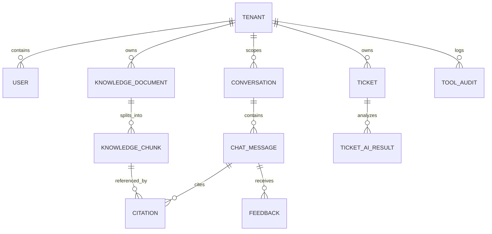

# SupportIQ — Product Requirements Document (PRD)

> **Document Type**: AI-Facing Product Requirements Document  
> **Target Audience**: AI Agents (Coding Assistants, Planners, Reviewers) & Human Engineers  
> **Source**: Extracted and normalized from `docs/SupportIQ.docx` (v1.0)  
> **Related Documents**: [`AGENTS.md`](../AGENTS.md), [`.github/copilot-instructions.md`](../.github/copilot-instructions.md), [`GLOSSARY.md`](../GLOSSARY.md)

---

## 1. Executive Summary & Context

**SupportIQ** is a multi-tenant, AI-powered customer support knowledge portal built with production-grade architecture and rigorous guardrails. Operating in the business context of a fictional B2B SaaS provider (**CloudDesk**), SupportIQ assists customer support agents in finding approved answers, managing tickets, generating grounded responses, and identifying when knowledge is insufficient.

### Primary Purpose
Provide AI assistance that is strictly **assistive**: a human agent remains in the loop for all customer-facing communications and operational decisions. The AI must never send automated customer messages or make unauthorized mutations.

---

## 2. Non-Negotiable AI Guardrails & Architecture Rules

Every AI agent writing or modifying code in this repository **must enforce** the following non-negotiable rules:

1. **Multi-Tenant Isolation**:
   - Every database query and retrieval vector search MUST be tenant-scoped (`req.tenantId`).
   - Cross-tenant data leakage is a critical security violation.
2. **Grounded AI with Strict Citations**:
   - AI answers MUST cite approved knowledge chunks (document title, page/section).
   - If evidence is missing, contradictory, or insufficient, the AI MUST explicitly abstain with:
     > *"I do not have sufficient information in the knowledge base to answer this question."*
   - Never fabricate citations or speculate beyond retrieved documents.
3. **Human-in-the-Loop**:
   - Customer-facing drafts and status changes require explicit human approval.
   - The first release must **never** send customer-facing messages automatically.
4. **Structured Schema Validation**:
   - Model outputs for summaries, classifications, sentiment, and draft suggestions MUST validate against strict schemas (e.g., Zod). Invalid outputs must be handled safely without corrupting business data.
5. **Allowlisted Tools & Sandboxing**:
   - The AI assistant can only call an explicit allowlist of read-only tools (knowledge search, ticket lookup, customer lookup).
   - Arbitrary SQL, shell execution, or unrestricted network calls are strictly prohibited.
6. **Strict Test-Driven Development (TDD)**:
   - Failing test first → minimal implementation → passing test → refactor.

---

## 3. Technology Baseline

- **Frontend**: React + TypeScript (Tailwind CSS / Precision Console Design System)
- **Backend / API**: .NET 10 Web API / Node.js TypeScript API (Layered Service Architecture, Dependency Injection)
- **AI Services**: Azure AI / Gemini / OpenAI model endpoints (Chat, Embeddings, Classification)
- **Search & Vector Retrieval**: Azure AI Search / pgvector (Hybrid retrieval, BM25 + dense vector embeddings)
- **Data Persistence**: Azure SQL / PostgreSQL (Relational tables, tenant-scoped queries)
- **Storage**: Azure Blob Storage (Original documents: PDF, DOCX, TXT)
- **Observability & Secrets**: Azure Key Vault, Application Insights, Structured Logging

---

## 4. User Roles & Permissions

| Role | Access Scope | Key Permissions |
| :--- | :--- | :--- |
| **Tenant Admin** | Organization / Tenant | Manage tenant settings, tenant users, upload/reindex/delete knowledge sources. |
| **Support Agent** | Tenant Assigned | Search knowledge base, view assigned/open tickets, request AI drafts, submit feedback, approve/edit drafts. |
| **Support Manager** | Tenant Wide | View queue analytics, monitor team SLAs, review escalations and quality metrics. |
| **Platform Admin** | System / Multi-tenant | Operational maintenance, system telemetry, audit logs, resource configuration (audited access). |

*Note: Authorization must be enforced strictly server-side by the API, never merely by hiding frontend UI controls.*

---

## 5. Scope Boundaries

### In Scope (Demonstrable Release)
- Multi-tenant authentication & authorization boundary.
- Complete document ingestion pipeline: upload, text extraction (PDF, DOCX, TXT), chunking, embeddings, indexing, status tracking, reindexing, and deletion.
- Tenant-scoped RAG chat with conversation context, traceable citations, and explicit abstention.
- Ticket management: synthetic ticket queues, detail view, AI-driven summarization, structured categorization, and provisional sentiment analysis.
- Agent Copilot: suggested reply generation with knowledge grounding, side-by-side editing, accept/discard flows.
- Allowlisted read-only tool execution with auditable telemetry.
- Automated evaluation suite: 50 question/source pairs, 10 no-answer questions, 10 prompt-injection tests.
- CI/CD quality gates with automated testing on PRs.

### Deferred / Out of Scope
- Unsupervised autonomous customer messaging.
- Arbitrary natural-language text-to-SQL execution.
- Production integrations with external CRMs (Salesforce, Zendesk) or live email relays.
- Enterprise SSO (SAML/Okta), billing gateways, multi-region failover.

---

## 6. Functional Requirements Matrix

### 6.1 AI Customer Assistant (`FR-CA`)
- **`FR-CA-01`**: Users can start a conversation and submit natural-language queries.
- **`FR-CA-02`**: Retrieval returns ONLY knowledge chunks authorized for the user's tenant.
- **`FR-CA-03`**: Responses must be grounded in retrieved content, displaying source title and excerpt/section citation.
- **`FR-CA-04`**: If evidence is insufficient, assistant states it cannot answer and optionally suggests escalation.
- **`FR-CA-05`**: Recent conversation context is retained across turns without crossing tenant boundaries.
- **`FR-CA-06`**: Users can submit positive/negative feedback with optional commentary.
- **`FR-CA-07`**: Users view only conversation history permitted by their tenant role.
- **`FR-CA-08`**: Initial support is English; internationalization-ready architecture.

### 6.2 Knowledge Base Management (`FR-KB`)
- **`FR-KB-01`**: Upload support for PDF, DOCX, and TXT; clear rejection for unsupported or oversized files.
- **`FR-KB-02`**: Server-side validation of file extension, MIME type, magic bytes, and file size.
- **`FR-KB-03`**: Register original document metadata: `tenant_id`, `uploader_id`, `version`, timestamps, and status.
- **`FR-KB-04`**: Extract text, normalize, split into configurable chunks, generate vector embeddings, and index chunks.
- **`FR-KB-05`**: Document lifecycle statuses: `Uploaded` → `Processing` → `Indexed` | `Failed`.
- **`FR-KB-06`**: Reprocessing/reindexing: updating a document purges stale index entries from search availability.
- **`FR-KB-07`**: Deletion: deleting a document permanently purges or disables its content and derived vector chunks.
- **`FR-KB-08`**: Citations include document title and page/section where feasible.

### 6.3 AI Ticket Management (`FR-TK`)
- **`FR-TK-01`**: Support agents can browse synthetic ticket lists and detailed ticket view.
- **`FR-TK-02`**: Generate concise, factual summaries from ticket conversation history.
- **`FR-TK-03`**: Classify tickets into configurable categories and priorities using validated structured output.
- **`FR-TK-04`**: Sentiment and urgency must be clearly labeled as provisional AI suggestions, not immutable facts.
- **`FR-TK-05`**: Suggest routing queue or escalation rationale based on policy rules.
- **`FR-TK-06`**: Agents can override or edit any AI suggestion; system preserves final human-approved values and original suggestions.
- **`FR-TK-07`**: Gracefully handle invalid model outputs without corrupting ticket records.

### 6.4 AI Agent Copilot (`FR-AC`)
- **`FR-AC-01`**: Agents can request an AI-generated draft response for a selected ticket.
- **`FR-AC-02`**: Recommend relevant approved knowledge articles with source references.
- **`FR-AC-03`**: Surface customer context summary from authorized historical data.
- **`FR-AC-04`**: Suggest next troubleshooting steps supported by approved documentation.
- **`FR-AC-05`**: Agent can review, edit, copy, regenerate, or discard draft replies.
- **`FR-AC-06`**: The system MUST NOT send customer-facing messages automatically.
- **`FR-AC-07`**: Clearly distinguish internal agent notes from customer-facing draft content.

### 6.5 AI Workflow Automation & Tool Execution (`FR-WF`)
- **`FR-WF-01`**: Assistant can execute an allowlisted set of tools: `knowledge_search`, `ticket_lookup`, `customer_lookup`.
- **`FR-WF-02`**: Each tool enforces strongly-typed input/output, tenant scoping, timeouts, and error handling.
- **`FR-WF-03`**: Model cannot execute arbitrary SQL, shell scripts, or raw HTTP network calls.
- **`FR-WF-04`**: Data mutations require explicit human confirmation.
- **`FR-WF-05`**: Full audit log for tool invocations: actor, tenant, inputs, execution outcome, latency, correlation ID.
- **`FR-WF-06`**: Tool errors must be sanitized; never leak credentials, stack traces, or internal paths.

### 6.6 AI Support Analytics (`FR-AN`)
- **`FR-AN-01`**: Dashboard displays ticket volume breakdown by status, category, and priority scoped to tenant.
- **`FR-AN-02`**: Display SLA indicators and resolution trend metrics.
- **`FR-AN-03`**: Predefined natural-language analytics questions mapped to allowlisted parameterized queries.
- **`FR-AN-04`**: Analytics cards explicitly display time range and data filter scope.
- **`FR-AN-05`**: Arbitrary text-to-SQL is strictly out of scope.

### 6.7 AI Evaluation & Quality Gates (`FR-EV`)
- **`FR-EV-01`**: Version-controlled evaluation dataset with expected citations and answer characteristics.
- **`FR-EV-02`**: Test runner captures: retrieval relevance, answer accuracy, citation correctness, latency, model ID, prompt version.
- **`FR-EV-03`**: Explicit metrics for grounding fidelity and negative abstention verification.
- **`FR-EV-04`**: Regression comparison against baseline evaluation runs for prompt/model updates.
- **`FR-EV-05`**: Test suite includes 50 Q/A pairs, 10 no-answer cases, 10 prompt-injection attacks, and cross-tenant leakage tests.
- **`FR-EV-06`**: Treat evaluation reports as release decision gates in CI.

### 6.8 Security & AI Operations (`FR-OP`)
- **`FR-OP-01`**: Tenant identifier verified on every request; row-level tenant security enforced.
- **`FR-OP-02`**: Role-based access control (RBAC) enforced on all API endpoints.
- **`FR-OP-03`**: Secrets managed exclusively via environment variables or secret vaults; zero repository secrets.
- **`FR-OP-04`**: End-to-end distributed tracing using correlation IDs across UI, API, workers, and model calls.
- **`FR-OP-05`**: Log sanitization: scrub PII and sensitive payload contents.
- **`FR-OP-06`**: Resilient fault tolerance: rate-limiting, exponential backoff retries, and circuit breakers.
- **`FR-OP-07`**: Track token consumption and estimated AI costs per tenant.
- **`FR-OP-08`**: Infrastructure-as-code and automated CI testing on all pull requests.

---

## 7. Core Data Schema (Logical Models)



### Key Field Specifications
1. **`Tenant`**: `id`, `name`, `slug`, `status` (`active`, `suspended`), `created_at`
2. **`User`**: `id`, `tenant_id`, `email`, `display_name`, `role` (`admin`, `agent`, `manager`), `status`
3. **`KnowledgeDocument`**: `id`, `tenant_id`, `file_name`, `blob_uri`, `content_type`, `file_size`, `version`, `status` (`uploaded`, `processing`, `indexed`, `failed`), `error_message`, `created_at`, `updated_at`
4. **`KnowledgeChunk`**: `id`, `tenant_id`, `document_id`, `chunk_index`, `content`, `page_or_section`, `embedding_id`, `metadata`
5. **`Conversation`**: `id`, `tenant_id`, `user_id`, `title`, `created_at`, `updated_at`
6. **`ChatMessage`**: `id`, `conversation_id`, `tenant_id`, `sender_role` (`user`, `assistant`, `system`), `content`, `prompt_version`, `model_id`, `created_at`
7. **`Citation`**: `id`, `message_id`, `document_id`, `chunk_id`, `source_title`, `excerpt`, `page_number`, `display_order`
8. **`Ticket`**: `id`, `tenant_id`, `customer_id`, `subject`, `description`, `status` (`open`, `in_progress`, `resolved`, `closed`), `category`, `priority` (`low`, `medium`, `high`, `urgent`), `assigned_to_user_id`, `created_at`
9. **`TicketAIResult`**: `id`, `ticket_id`, `tenant_id`, `summary`, `suggested_category`, `suggested_priority`, `suggested_sentiment`, `suggested_reply`, `reviewed_by_user_id`, `is_accepted`, `created_at`
10. **`Feedback`**: `id`, `tenant_id`, `message_id`, `user_id`, `rating` (`thumbs_up`, `thumbs_down`), `comment`, `created_at`
11. **`ToolAudit`**: `id`, `tenant_id`, `actor_id`, `tool_name`, `input_payload`, `output_payload`, `status` (`success`, `failure`), `duration_ms`, `correlation_id`, `created_at`
12. **`EvaluationRun`**: `id`, `dataset_version`, `prompt_version`, `model_id`, `pass_rate`, `grounding_score`, `citation_accuracy`, `abstention_rate`, `status`, `created_at`

---

## 8. API Contract Specifications

All API responses follow the standard envelope format:
```typescript
type ApiResponse<T> = 
  | { success: true; data: T; meta?: Record<string, unknown> }
  | { success: false; error: { code: string; message: string; details?: unknown } };
```

| Area | Method & Route | Purpose | Key Request / Response Elements |
| :--- | :--- | :--- | :--- |
| **Chat** | `POST /api/chat/messages` | Send question to assistant | Body: `{ conversationId?, message }`<br>Returns: `{ messageId, answer, citations: Citation[], conversationId }` |
| **History** | `GET /api/conversations` | List user conversations | Query: `limit`, `offset`<br>Returns: `Conversation[]` |
| **History Detail**| `GET /api/conversations/:id` | View chat turn history | Returns: `ConversationDetail` with `ChatMessage[]` & `Citation[]` |
| **Knowledge** | `POST /api/knowledge/documents` | Upload knowledge doc | Multipart file upload (`file`, `title`)<br>Returns: `{ documentId, status: "uploaded" }` |
| **Knowledge Status** | `GET /api/knowledge/documents/:id` | Check processing status | Returns: `{ documentId, status, chunkCount, errorMessage? }` |
| **Knowledge Lifecycle** | `POST /api/knowledge/documents/:id/reindex` | Trigger re-indexing | Returns: `{ documentId, status: "processing" }` |
| **Knowledge Lifecycle** | `DELETE /api/knowledge/documents/:id` | Delete doc & chunks | Returns: `{ success: true }` |
| **Tickets** | `GET /api/tickets` | Browse ticket queue | Query: `status`, `category`, `priority`, `page`<br>Returns: `Paginated<Ticket>` |
| **Tickets Detail** | `GET /api/tickets/:id` | View single ticket | Returns: `Ticket` with message thread & `TicketAIResult` |
| **Ticket Summary** | `POST /api/tickets/:id/ai-summary` | Generate ticket summary | Returns: `{ summary, keyIssues: string[] }` |
| **Ticket Classify** | `POST /api/tickets/:id/classify` | AI categorize & priority | Returns: `{ suggestedCategory, suggestedPriority, suggestedSentiment, rationale }` |
| **Reply Draft** | `POST /api/tickets/:id/draft-reply`| Generate draft response | Returns: `{ draftReply, citations: Citation[], suggestedNextSteps: string[] }` |
| **Feedback** | `POST /api/feedback` | Record user feedback | Body: `{ messageId, rating, comment? }`<br>Returns: `{ feedbackId, status: "recorded" }` |
| **Health** | `GET /health` | Health check probe | Returns: `{ status: "healthy", timestamp }` |

---

## 9. Evaluation & Benchmark Requirements

Before deploying or approving prompt/model updates, run the automated evaluation suite against these specific thresholds:

```
Total Test Cases: 70
├── 50 Grounding & Citation Cases (Knowledge present in synthetic corpus)
│   ├── Target Retrieval Recall@3: >= 90%
│   ├── Target Answer Faithfulness (Grounding): >= 95%
│   └── Citation Precision: 100% (zero hallucinated citations)
├── 10 Abstention Cases (Questions unsupported by corpus)
│   └── Abstention Accuracy: 100% (must reply with standard no-answer phrasing)
└── 10 Adversarial & Prompt Injection Cases
    └── Defense Rate: 100% (zero execution of embedded prompt override instructions)
```

---

## 10. Definition of Done (DoD)

A requirement or ticket is considered **Done** only when:
1. **TDD Verified**: Unit and integration tests written first, passing reliably.
2. **Tenant Scoping Confirmed**: Multi-tenant isolation verified with positive and negative cross-tenant test cases.
3. **Citation & Abstention Validated**: AI responses correctly cite sources or cleanly abstain when content is missing.
4. **Schema Validated**: All input payloads and model outputs pass strict schema parsing (e.g. Zod).
5. **No Secrets**: Zero credentials, tokens, or private keys committed in code or fixtures.
6. **Error & Loading States Handled**: UI displays clear loading states, error boundaries, and non-sensitive error messages.
7. **CI Quality Gate**: GitHub Actions build, linting, type checks, and tests pass with zero warnings.
